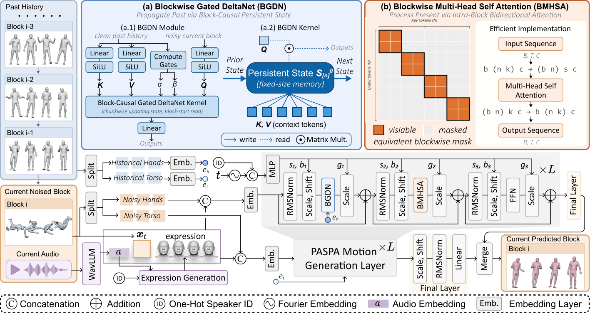
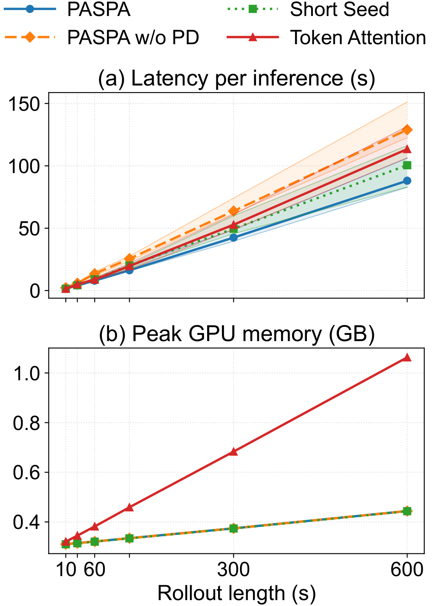

# 原理详解 (Principles)

> 本文档是仓库使用 README 的配套**原理文档**，专门解释项目的方法学、模型架构、训练与推理契约。如果你只想跑通项目，请直接读 [`README_zh.md`](./README_zh.md) 或 [`README.md`](./README.md)，本文档不是必须的。
>
> 本仓库提供**两种训练范式**：
> - **BLDTrainer**：块式因果自回归扩散（本项目主方法）
> - **EmageTrainer**：全局非因果扩散 baseline（复现 [GlobalDiff](https://github.com/Human3DAIGC/GlobalDiff)）
>
> 本文以 BLDTrainer 为主线展开。EmageTrainer 的原理基本是去掉"块式因果"和 "KV-Cache 推理"两条，其余 (Flow Matching / SMPLX / 几何损失 / 6D 旋转 / 双流 hand-body / dual-CFG 等) 与 BLD 共用。

---

## 目录

1. [任务建模：音频驱动全身动作生成](#1-任务建模)
2. [Flow Matching 训练目标](#2-flow-matching)
3. [双流 CausalEmage 架构](#3-causalemage-架构)
4. [块式因果注意力](#4-块式因果注意力)
5. [Gated DeltaNet 跨块记忆](#5-gated-deltanet-跨块记忆)
6. [6D 旋转表示](#6-6d-旋转表示)
7. [Teacher Forcing 训练 ↔ KV-Cache 推理契约](#7-teacher-forcing--kv-cache-契约)
8. [推理管线 CausalEmageInferencePipeline](#8-推理管线)
9. [EmageDiffusion 损失分解](#9-emagediffusion-损失分解)
10. [损失时间权重方案](#10-损失时间权重)
11. [history-CFG 双向无条件引导](#11-history-cfg)

---

## 1. 任务建模

**输入**：长度为 $T$ 的 16 kHz 音频 $a \in \mathbb{R}^{16000 \cdot T/30}$，演员 ID $i \in \{0, 1, \dots, 30\}$。

**输出**：与之同步的 30 fps SMPL-X 全身动作：

| 字段 | 形状 | 说明 |
|---|---|---|
| `body / hand pose` | $(T, 55, 3)$ → $(T, 55 \times 6) = (T, 330)$ | 全身 55 关节，axis-angle 转 6D |
| `trans` | $(T, 3)$ | 根关节全局位移 |
| `contact` | $(T, 4)$ | 双脚 contact 标签 |
| `expression` | $(T, 100)$ | SMPL-X 面部表情，由 `SimpleSpeechModel`（独立 head）单独预测 |

`tar_motion = concat([pose_6d, trans, contact])`，shape $(T, 330 + 3 + 4) = (T, 337)$。

---

## 2. Flow Matching

我们用 Flow Matching [Lipman et al. ICLR'23] 代替传统 DDPM 作为扩散范式。

**前向过程**（线性插值）：给定干净数据 $x_0$ 和噪声 $\epsilon \sim \mathcal{N}(0, I)$，定义

$$x_t = (1 - t) \cdot x_0 + t \cdot \epsilon, \quad t \in [0, 1]$$

**预测目标**：直接预测 $\hat{x}_0 = f_\theta(x_t, t, c)$（`prediction_type: xstart`），其中 $c$ 是条件（音频 + 历史块）。

**训练损失**（基础项）：

$$\mathcal{L}_{\text{x0}} = \mathbb{E}_{t, x_0, \epsilon} \left[ w(t) \cdot \|\hat{x}_0 - x_0\|^2 \right]$$

实际 canonical 路径里 $\mathcal{L}_{\text{x0}}$ 只是损失字典中的 `mse_motion / mse_translation` 项，还要加上一系列几何与时序约束损失（见 [§9](#9-emagediffusion-损失分解)）。

**采样**：Flow-Match Euler 积分。canonical 推理 10 步即可（参见 `EmageFlowEulerSampler`）。

**和 DDPM 对比**：
- 推理步数从 1000 → 10
- 训练目标方差更小
- 采样允许任意 ODE 求解器

时间步采样器在训练里是 **logit-normal** 分布（`weighting_scheme: logit_normal`，`logit_mean=-1.0`，`logit_std=1.0`），canonical BLD 倾向偏向较低 $t$（即更接近 clean 的样本，更易学到结构）。

---

## 3. CausalEmage 架构

<div align="center">
  
  <br/>
  <sub>整体网络：hand / body 双流编码 → 块内双向自注意力 + 跨块 DeltaNet 记忆 × depth=6 → 双流解码</sub>
</div>

**双流分离**。每帧的 $(330+3+4)$ 维 motion 张量按"hand"和"body"两条流分别投影：

```
输入 motion (B, T, 337)
  ├── hand: 30 关节 × 6 = 180                       → hand_in(linear)  → (B, T, H)
  └── body: 25 关节 × 6 + trans 3 + contact 4 = 157 → body_in(linear)  → (B, T, H)
                                                          ↓
                                  ┌─────────────────────────────────────────┐
                                  │      CausalEmageBlock × depth=6         │
                                  │  ┌──────────────────────────────────┐   │
                                  │  │  Block-wise Self-Attention       │   │
                                  │  │  (块内 hand+body 双向)           │   │
                                  │  ├──────────────────────────────────┤   │
                                  │  │  Cross-Block Memory (DeltaNet)   │   │
                                  │  │  (块间因果，从历史 clean 块汇聚) │   │
                                  │  ├──────────────────────────────────┤   │
                                  │  │  FFN + AdaLN time modulation     │   │
                                  │  └──────────────────────────────────┘   │
                                  └─────────────────────────────────────────┘
                                                          ↓
  ├── hand_final: (B, T, H) → (B, T, 180)
  └── body_final: (B, T, H) → (B, T, 157)
```

**条件融合**（block 入口前）。条件包括：
- expression（$E$ 100 维表情向量，由 `SimpleSpeechModel` 从音频预测）
- audio context（HuBERT-large $(B, T, 1024)$ 特征）
- timestep embedding（Fourier）

融合方式：

```python
hand = hand_fuse(cat([
    hand_in(motion_hand),
    xhand_in(cat([motion, expression])),   # 与 expression 联合编码
    context_embed                          # 音频条件嵌入
]))
body = body_fuse(cat([
    body_in(motion_body),
    xbody_in(cat([motion, expression])),
    context_embed
]))
```

**AdaLN 时间调制**。每层 Transformer block 使用时间步信息生成 `[shift, scale, gate] × 3`（attn / cross / ffn），分别对 normalization 输出做调制：

```
x_out = gate × (scale × LayerNorm(x) + shift)
```

---

## 4. 块式因果注意力

CausalEmage 的核心 inductive bias：把 $T$ 帧切成 `num_frame_per_block=64` 帧的块。

### 4.1 块内双向自注意力（Block-wise Self-Attention）

每块内部 $64 \times 2 = 128$ 个 token（hand 64 + body 64）相互全连接（双向）。我们用 **FlexAttention** 的 `BlockMask` 高效实现这个稀疏 pattern。

**掩码可视化**（4 块每块 4 帧）：

```
       Q (current)
       [0-3] [4-7] [8-11] [12-15]
K/V:
[0-3]   ✓     ×     ×     ×
[4-7]   ×     ✓     ×     ×
[8-11]  ×     ×     ✓     ×
[12-15] ×     ×     ×     ✓
```

### 4.2 跨块因果记忆（Cross-Block Causal Memory）

Query 是当前块的 noisy token，Key/Value 来自**所有历史块的 clean token**（teacher forcing 训练时）或**历史块的生成结果**（推理时自回归）。

掩码：当前块只能看历史块 + 自己。

```
       Q (current)
       [0-3] [4-7] [8-11] [12-15]
K/V (history clean):
[0-3]   ✓     ✓     ✓     ✓
[4-7]   ×     ✓     ✓     ✓
[8-11]  ×     ×     ✓     ✓
[12-15] ×     ×     ×     ✓
```

这种划分让训练既能保留块内双向上下文（生成质量），又能在推理时**自回归地一块一块生成**（流式能力）。

---

## 5. Gated DeltaNet 跨块记忆

把跨块因果记忆从 softmax-attention 换成 **Gated DeltaNet** [Yang et al. ICLR'25]：

### 5.1 状态更新公式

DeltaNet 维护一个 $(d_k, d_v)$ 矩阵状态 $S_t \in \mathbb{R}^{d_k \times d_v}$，每步更新：

$$S_t = \alpha_t \odot S_{t-1} + \beta_t (k_t \otimes v_t)$$

$$o_t = \text{normalize}(q_t S_t)$$

其中 $\alpha_t, \beta_t$ 是从当前输入 $x_t$ 用低秩投影预测的 **内容自适应门控**：
- $\alpha_t$：遗忘门（保多少历史）
- $\beta_t$：写入门（学多少新信息）

### 5.2 相比 Softmax-Attention 的优势

| 维度 | Softmax-Attn | Gated DeltaNet |
|---|---|---|
| 时间复杂度 | $O(T^2)$ | $O(T)$ |
| KV-Cache 内存 | 随历史线性增长 | 固定 $d_k \times d_v$ |
| 因果性 | 显式 mask | state 天然只依赖历史 |
| 长序列 | 慢 | 适合 |

<div align="center">
  
  <br/>
  <sub>实测：块式因果 + DeltaNet 让每块推理延迟随序列长度增长保持常数；全局 softmax-attention baseline 是 O(T²)。</sub>
</div>

### 5.3 配套实现细节

我们基于 [Flash-Linear-Attention](https://github.com/fla-org/flash-linear-attention) 的 Triton kernel 扩展实现 block-causal 变体（详见 [Acknowledgements](./README_zh.md#致谢)）。

canonical 配置：
```yaml
deltanet_gate_low_rank_dim: -1          # -1 = 全秩
deltanet_gate_logit_normalizer: 1.0
deltanet_use_triton_kernel: true        # 用 Triton kernel 加速
```

---

## 6. 6D 旋转表示

SMPL-X 的 55 个关节旋转使用 **6D 表示** [Zhou et al. CVPR'19] 而非欧拉角或四元数。

### 6.1 编码

```
旋转矩阵 R = [r₁ r₂ r₃] ∈ R^{3×3}  →  取前两列  →  [r₁; r₂] ∈ R^6
```

### 6.2 解码（Gram-Schmidt 正交化）

```python
def rot6d_to_matrix(r6d):
    a1, a2 = r6d[..., :3], r6d[..., 3:]
    b1 = normalize(a1)
    b2 = normalize(a2 - dot(a2, b1) * b1)
    b3 = cross(b1, b2)
    return stack([b1, b2, b3], dim=-1)  # 保证 SO(3) 合法
```

### 6.3 为什么不用其它表示

- **欧拉角**：万向锁 + 顺序歧义
- **四元数**：双覆盖（$q$ 和 $-q$ 表示同一旋转），需要归一化约束
- **9D 旋转矩阵**：6 个冗余维度
- **6D 表示**：在 SO(3) 流形上连续可微，梯度稳定，最紧凑的无歧义表示

### 6.4 配套测地距离损失（可选）

如果 `lambda_rotation > 0`，加一项测地距离：

$$\mathcal{L}_{\text{geo}}(R_1, R_2) = \arccos\left(\frac{\text{tr}(R_1 R_2^T) - 1}{2}\right)$$

canonical BLD 配置 `lambda_rotation=0.0`（结构损失 + rcxyz 已经隐式约束旋转质量）。

---

## 7. Teacher Forcing ↔ KV-Cache 契约

这是整个项目最容易出错的对偶设计：训练时用 teacher forcing，推理时用 KV-Cache 自回归。两边必须**保持完全一致**否则长序列生成会崩溃。

### 7.1 训练阶段（`train.teacher_forcing=true`）

```
Block 0: Q = noisy[0:64],     K/V = clean[0:64]
Block 1: Q = noisy[64:128],   K/V = clean[0:128]   ← 用真实历史
Block 2: Q = noisy[128:192],  K/V = clean[0:192]   ← 用真实历史
...
```

**关键**：`model_kwargs["clean_motion"] = latent_motion`，模型用它作为 K/V，noisy `motion_t` 作为 Q。

### 7.2 推理阶段（自回归）

```
Block 0: Q = noisy[0:64],     K/V = clean_seed（若有 seed 帧）
Block 1: Q = noisy[64:128],   K/V = generated[0:64]    ← 用生成历史
Block 2: Q = noisy[128:192],  K/V = generated[0:128]   ← 用生成历史
...
```

`generated[0:N]` 是前面所有块去噪完成的结果，通过 KV-Cache 累积。

### 7.3 训练-推理一致性陷阱

- DeltaNet KV-Cache state 形状是 `(B, num_heads, head_dim, head_dim)`，**永远保持 fp32**（数值稳定性，即便模型其余部分也是 fp32）—— 不要改 dtype
- `kv_cache_offset` 和 `context_offset` 都以 `seed_num_frames` 为准
- `prefill_only` 和 `update_kv_cache` 标志位：`_seed_prefill` 写 seed 用 `prefill_only=True, update_kv_cache=True`；`_sample_block_with_cache` 在去噪结束后再调用 `_prefill_kv_cache(clean_motion=denoised_pred)` 把生成块写进 cache

---

## 8. 推理管线

`diffusion/pipeline/emage_inference.py:CausalEmageInferencePipeline.inference_with_seed`。

### 8.1 KV-Cache 数据结构

每个 Transformer 块维护跨块 KV-Cache。对 DeltaNet：

```python
kv_cache = {
    "state": Tensor[B, num_heads, head_dim, head_dim],  # 一直 fp32
    "global_end_index": int,   # 全局已 push 的 token 数
    "local_end_index": int,    # 循环缓冲区写指针
}
```

`max_attention_size` 控制最长保留窗口（默认 256）。

### 8.2 块式采样流程

```python
for block_idx in range(num_blocks):
    # 1. 初始化当前块的噪声
    x_noisy = randn(B, num_frame_per_block, motion_dim)

    # 2. 若 block_idx == 0 且有 seed，先 prefill seed 到 cache
    if block_idx == 0 and seed_num_frames > 0:
        _seed_prefill(seed_motion)  # → _prefill_kv_cache(prefill_only=True)

    # 3. 扩散采样：N 步 Euler 积分
    x_clean = _sample_block_with_cache(x_noisy, ...)  # 取 cache 作 K/V

    # 4. 把当前块的 clean 预测推进 cache 供下一块用
    _prefill_kv_cache(clean_motion=x_clean, prefill_only=True, update_kv_cache=True)

    output[block_idx] = x_clean
```

### 8.3 `speech_model` 在两条路径上的差异

`SimpleSpeechModel`（独立 head，预测 expression）跑两遍：
- **训练**：在 `EmageTrainer.get_expression` 里以 `in_audio`（原始 wav 或预算 HuBERT 特征）为输入
- **推理**：在 `CausalEmageInferencePipeline` 里以 `context_`（音频 encoder 输出 interpolate 到 motion fps 后）为输入

两条路径输入形式不同（原始 wav vs encoder 输出），但应该输出可比的 expression —— 如果改动 audio encoder 实现，记得验证两条路径仍兼容。

---

## 9. EmageDiffusion 损失分解

`diffusion/model/emage_diffusion.py:EmageDiffusion` 继承 `SpacedDiffusion`，把 `loss_type=emage_mse` 解析为一个复合损失字典：

| Loss key | 计算 | canonical λ |
|---|---|---|
| `mse_motion` | rot6d MSE，按时间步加权 | 1.0 (`lambda_rot6d`) |
| `mse_translation` | translation MSE | 1.0 (`lambda_translation`) |
| `geodesic_loss` | 测地旋转损失 | 0.0 (`lambda_rotation`) — 关 |
| `motion_rcxyz` | FK 关节位置损失 | 1.0 (`lambda_rcxyz`) |
| `motion_vel_rcxyz` | FK 关节速度损失 | 0.0 — 关 |
| `motion_acc_rcxyz` | FK 关节加速度损失 | 0.0 — 关 |
| `structural_loss` | 骨长一致性 + 多关节几何约束 | 1.0 (`lambda_struct_loss`) |
| `translation_vel_loss` | trans 速度损失 | 0.0 — 关 |
| `translation_acc_loss` | trans 加速度损失 | 0.0 — 关 |
| `latent_loss` | VAE-latent KL（用 `MaskedVAE2/3`）| 0.0 (`lambda_latent_loss`) — canonical 是 identity VAE，关 |
| `block_boundary_loss` | 块边界 motion 平滑 | 1.0 (`lambda_block_boundary`) |
| `logvar` | EDM 风格 logvar 正则项 | 跟随 `+model.model_wrapper.params.return_logvar=true` |

**FK 损失**：通过 `forward_kinematics_func`（`EmageTrainer.forward_kinematics`，封装 `FK.GFKWraper`）从预测的 6D 旋转 + trans 推出全身顶点位置；与 GT 顶点比较。

**`geometric_loss_logvar_mode=detach`**：FK loss 不带 logvar 反传，只让 motion MSE 项受 logvar 调权。

### 9.1 复合损失的实际汇总

`emage_diffusion.py` 末尾把每个 key 的 mean 累加进 `terms["loss"]`，每个 key 同时在 `terms[k]` 单独保留供日志记录。

### 9.2 添加新损失项的三步

1. 在 `loss_function` 的 `EMAGE_MSE` 分支里实现
2. 在 yaml 加 `λ_*` 字段
3. 自动写入 `terms[k]`

---

## 10. 损失时间权重

`EmageDiffusion.loss_weighting` 支持多种 timestep-wise 权重模式：

| Mode | 公式 | 用途 |
|---|---|---|
| `uniform` | $w(t) = 1$ | 默认 |
| `inverse_poly` | $w(t) = 1 / (1 + k \cdot t_{\text{norm}}^\alpha)$ | 低噪样本权重更高 |
| `flow_x0_clipped` | $w(t) = \min(\frac{1}{t^2}, \gamma)$ | Flow-matching 优化 |
| `min_snr` | $w(t) = \min(\text{SNR}(t), \gamma)$，$\text{SNR}(t) = (1-t)^2 / t^2$ | Min-SNR-γ 训练稳定化 |

canonical BLD 走 `loss_weighting_config=null`，即等价 `uniform`（默认 1.0），但通过 `+model.model_wrapper.params.return_logvar=true` 启用了 **logvar 自适应权重**：模型自己学一个 per-frame logvar，用 $\exp(-\sigma) \cdot \mathcal{L} + \sigma$ 形式做权重 + 正则，等效于 EDM 的 uncertainty-weighted loss。

---

## 11. history-CFG

canonical 用 **dual-CFG**：同时对 audio 条件和 history（cross-block KV）条件做 classifier-free guidance。

### 11.1 训练时的 unconditional drop

`BLDCFGGuider`（`diffusion/guider/guider.py`）在训练时以概率 `ucg_prob=0.1` 做条件 drop：

- audio dropout：把 audio context 替换成 zeros，让模型学 "audio-uncond"
- history dropout：把 cross-block K/V 替换成 learned null state（`history_cfg_null_state_mode=learned`），让模型学 "history-uncond"

具体到块层级，每块各自决策 `history_cfg_p_clean=0.7 / p_null=0.1`（剩下 0.2 走当前块的中间状态作为弱条件，详见 `causal_block.py` 中的 history-CFG 实现）。

### 11.2 推理时的 dual 引导公式

$$\hat{\epsilon} = (1 + s_a + s_h) \epsilon(a, h) - s_a \epsilon(\emptyset_a, h) - s_h \epsilon(a, \emptyset_h) + \text{...}$$

其中 $s_a$ = `cfg_audio_scale=2.5`，$s_h$ = `cfg_history_scale=2.0`。`cfg_mode=state_first` 指定先做 history-CFG 再做 audio-CFG 的组合顺序。

### 11.3 区间触发

`cfg_schedule_type=interval` + `cfg_schedule_kwargs.start=100, end=600` 表示**只在 $t \in [100, 600]$ 区间内启用 CFG**，区间外用 `outside_scale=1.0`（即纯条件）。这能避免极低/极高噪声步骤里 CFG 引入 artifact。

---

## 12. EmageTrainer (GlobalDiff 复现) 与 BLDTrainer 的差异

复现 [GlobalDiff (AAAI'26)](https://github.com/Human3DAIGC/GlobalDiff) 时只需要把 BLD 的因果性 strip 掉：

| 维度 | BLDTrainer (本项目主方法) | EmageTrainer (GlobalDiff 复现) |
|---|---|---|
| 模型 | `CausalEmage` + `CausalEmageBlockDeltaNet` | `SanaEmageNoTrans` + `SanaEmageNoTransSelfAttnBlock` |
| 注意力 | 块内自注意力 + 跨块 DeltaNet 记忆 | 全局自注意力（无块结构、无 causality）|
| Teacher Forcing | 是 | 否 |
| `num_frame_per_block` | 64 | N/A |
| KV-Cache 推理 | 是 | 否，全序列一次性出 |
| CFG | dual (audio + history) | 单 audio CFG，`cfg_motion_scale=7.5` |
| 推理流式性 | 是 | 否 |
| 默认序列长度 | 256 帧（4 块）| 60 帧 |
| 损失项 | `lambda_block_boundary=1.0` 启用 | `lambda_motion_prompt=0.1`、`lambda_trans_prompt=0.1` 启用（条件 prompt 损失）|

两条路径**共用**同一个 `EmageDiffusion` 损失函数、同一个 `SimpleSpeechModel`（expression 预测）、同一个 `FK` 工具、同一个 BEAT-X LMDB 数据流。

---

## 13. 工程上的两个非显然契约

### 13.1 Resume 不覆盖原 run

`main.py` 注册了 `calc_work_dir` resolver：resume 时（`resume_from=<ckpt>` 非空）自动在原实验目录下新建 `output1/`、`output2/` 等子目录，**永不覆盖之前的 checkpoint / log**。Rank 0 通过 `dist.FileStore` 决定路径并广播给其它 rank。

### 13.2 `mixed_precision='no'` 是硬约束

所有模型 yaml 都设了 `mixed_precision: 'no'`。本项目训练 **只用 float32**，不要随便开 BF16 或 FP16。原因：FK loss 涉及 SMPL-X 矩阵乘 + Gram-Schmidt 正交化，低精度容易爆。

---

## 致谢

参见 [README](./README_zh.md#致谢) 致谢章节。本文档涉及的 GlobalDiff、SANA、FLA、Self-Forcing、SMPL-X、Emage Evaltools 各自的许可与引用都在那里列出。
