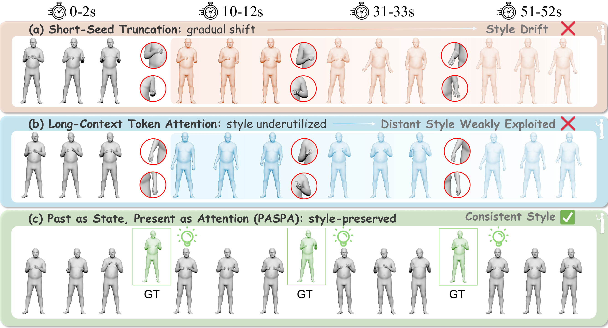
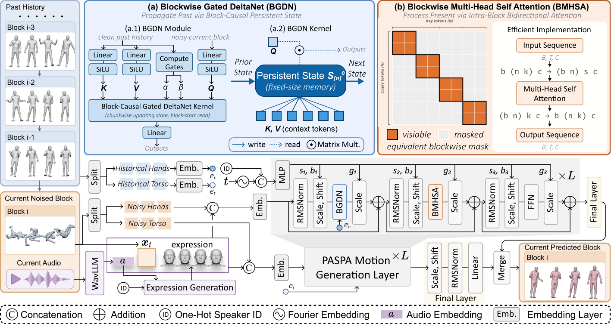

<div align="center">

# Past as State, Present as Attention: Persistent-State Blockwise Flow Matching for Long-Horizon Co-Speech Motion Generation

[](https://openreview.net/forum?id=dGHAQR4OKs)
[](https://ly403.github.io/PASPA/)
[](https://arxiv.org/abs/2610.32373)
[](https://github.com/Ly403/PASPA/)
[](LICENSE)

English | [简体中文](README_zh.md)

**🎉 Accepted at the Fortieth Annual Conference on Neural Information Processing Systems (NeurIPS 2026).**

Yi Liu<sup>1,3</sup>,
Xiangyue Zhang<sup>2</sup>,
Jianfang Li<sup>3,*</sup>,
Jia Ma<sup>1</sup>,
Yisheng He<sup>3</sup>,
Jianqiang Ren<sup>3</sup>

<sup>1</sup>Tongji University &nbsp;&nbsp;
<sup>2</sup>The University of Tokyo &nbsp;&nbsp;
<sup>3</sup>Alibaba Group

<sup>*</sup>Corresponding author

<br>

**Past → Persistent State &nbsp;&nbsp;·&nbsp;&nbsp; Present → Bidirectional Attention**

<br>

<a href="#news">News</a> &nbsp;•&nbsp;
<a href="#overview">Overview</a> &nbsp;•&nbsp;
<a href="#method">Method</a> &nbsp;•&nbsp;
<a href="#installation">Installation</a> &nbsp;•&nbsp;
<a href="#resources">Checkpoints</a> &nbsp;•&nbsp;
<a href="#training">Training</a> &nbsp;•&nbsp;
<a href="#evaluation">Evaluation</a> &nbsp;•&nbsp;
<a href="#license">License</a>

</div>

<a id="news"></a>

## 📰 News

- ✅ **2026-11-21:** Released the PASPA training, inference, and evaluation code, together with the portable BEAT2 reproduction recipe.
- ✅ **2026-11-21:** Released the best BEAT2 checkpoints and generated-motion results for All Speakers (`PID all`) and 1 Speaker / Scott (`PID 2`), including the resolved Hydra configuration and original recipe snapshot.
- ✅ **2026-11-21:** Released SHOW/TalkSHOW support: WavLM Large face-network training, LMDB preparation, three block/sequence profiles, checkpoint-directory evaluation, and TalkSHOW/DiffSHEG-compatible offline evaluators.
- ✅ **2026:** PASPA was accepted at NeurIPS 2026.

> [!NOTE]
> Original BEAT2/BEAT-X and SHOW data, SMPL-X model files, and other restricted assets are not redistributed. Any bundled or downloaded third-party files remain governed by their original licenses.

<p align="center">
  
</p>
<p align="center"><em>PASPA preserves motion style over a 52-second generation by carrying the past as a compact persistent state.</em></p>

<a id="overview"></a>

## 🔍 Overview

Long-horizon co-speech generation must preserve both local motion detail and slowly varying speaker style. Existing segment-by-segment methods commonly keep only a short recent seed, which can cause gradual style drift, or attend to an increasingly long explicit history, which raises cost and is difficult to learn from limited motion data.

PASPA starts from a simple asymmetry: past motion mainly carries persistent stylistic information, while the current segment contains fast-changing local dynamics. It therefore compresses earlier blocks into a recurrent Gated DeltaNet state and applies full bidirectional attention only within the current block—**past as state, present as attention**.

### ✨ Highlights

- **Persistent long-horizon style:** a block-level recurrent state selectively summarizes all preceding motion without retaining an ever-growing token history.
- **Detailed current motion:** blockwise bidirectional self-attention models fine-grained dynamics inside each generated segment.
- **Training and rollout designed together:** multi-block flow-matching supervision exposes the model to variable history lengths; prefill/decode state caching avoids recomputing the past.
- **Controllable conditioning:** hybrid classifier-free guidance jointly controls speech and historical dependence. The same recipe is evaluated on both BEAT2 and SHOW.

<a id="method"></a>

## 🧠 Method

<p align="center">
  
</p>
<p align="center"><em>BGDN summarizes inter-block history; BMHSA models fine-grained dynamics within the current block.</em></p>

PASPA uses a six-layer, 65.2M-parameter backbone. Each layer combines Blockwise Gated DeltaNet (BGDN) for inter-block history propagation with Blockwise Multi-Head Self-Attention (BMHSA) for intra-block interaction. During training, four contiguous blocks receive independently sampled, weakly monotonic noise levels and are supervised together. During inference, historical blocks are prefetched once into a fixed-size state; each new block then reuses that cache for iterative flow-matching decoding.

Speech is represented with frozen WavLM Large features. A frozen speaker-conditioned expression predictor supplies 100-dimensional facial coefficients, while PASPA generates the 55-joint body and hand motion plus global translation. The released main configuration uses 64-frame blocks, 256-frame training windows, and 10 sampling steps.

### 🏆 Results at a glance

| Dataset and protocol | PASPA FGD ↓ | Strongest listed baseline FGD ↓ |
|---|---:|---:|
| BEAT2, 1 Speaker (`FGD × 10`) | **3.71** | GestureLSM: 4.09 |
| BEAT2, All Speakers (`FGD × 10`) | **2.33** | GlobalDiff: 2.63 |
| SHOW, DiffSHEG protocol | **0.00111** | GlobalDiff: 0.00198 |

The paper also reports diversity, beat consistency/alignment, face MSE, long-horizon degradation, efficiency, and a blind user study. Use the exact dataset split and evaluator named in the paper when comparing numbers; TalkSHOW and DiffSHEG FGD values are not interchangeable.

> [!TIP]
> Questions, bug reports, and reproducibility discussions are welcome in [GitHub Issues](https://github.com/Ly403/PASPA/issues).

<a id="installation"></a>

## 🛠️ Installation

The released setup targets Linux, Python 3.12, and PyTorch 2.6. Choose the installer matching your CUDA environment:

```bash
# CUDA 12.4
bash environment_setup.sh paspa

# CUDA 11.8
bash environment_setup118.sh paspa

conda activate paspa
```

Both setup scripts install the project and download the EMAGE assets, evaluation assets, Vocos, and WavLM Large into `tools/`. Training remains FP32; the release launchers do not enable BF16 or FP16.

<a id="resources"></a>

## 📦 Data and checkpoints

### 📥 Pretrained PASPA checkpoints

| BEAT2 setting | Checkpoint | Generated motions |
|---|---|---|
| All Speakers (`PID all`) | [`best_pid_all.pth`](https://drive.google.com/file/d/1-phXGmj88j6xJHr1r_nNqHoPx8G6Vjwi/view?usp=sharing) | [Download results](https://drive.google.com/file/d/1M9zc3v3XqEQWbq94OykWaf1jnUdTnLnM/view?usp=sharing) |
| 1 Speaker / Scott (`PID 2`) | [`best_pid_2.pth`](https://drive.google.com/file/d/1tZKrmwMVqItSUjB00Tdov0duedPoL7Hp/view?usp=sharing) | [Download results](https://drive.google.com/file/d/1SvFMNXY1Jb-aOTMEMBc30pS3RH-59E4q/view?usp=sharing) |

Both checkpoints were produced with the same training recipe. The saved
[resolved Hydra configuration](reproductions/beat2/best_checkpoint_config.yaml)
and [original shell snapshot](reproductions/beat2/original_best_recipe.sh) are
provided for provenance and parameter inspection. They retain historical paths;
use the portable `train_scripts/train_beat2.sh` launcher for a new run. See the
[artifact notes](reproductions/beat2/README.md) for details.

Use `model.load_from=/path/to/checkpoint.pth` for inference or evaluation. Use `resume_from=/path/to/checkpoint.pth` only when restoring the complete training state.

### BEAT2 / BEAT-X

Obtain BEAT2/BEAT-X under its dataset terms. Its root must contain `smplxflame_30/`, `wave16k/`, and `train_test_split.csv`. Create one LMDB per split; the following is the 256-frame example:

```bash
export BEAT2_ROOT=/absolute/path/to/beat_english_v2.0.0
export BEAT2_LMDB_DIR=/absolute/path/to/beat2_lmdb
export WAVLM_DIR="$PWD/tools/wavlm-libri-clean-100h-large"
mkdir -p "$BEAT2_LMDB_DIR"

for SPLIT in train val test; do
  CUDA_VISIBLE_DEVICES=0 python scripts/create_lmdb_optimized.py "$BEAT2_ROOT" \
    --split "$SPLIT" --seq_size 256 --stride_size 20 \
    --local_rotation 0 --model_type wavlm --model_id "$WAVLM_DIR" \
    --lmdb_path "$BEAT2_LMDB_DIR/${SPLIT}_seq256_global.lmdb"
done
```

The included `tools/best.pt` is the default speech model. Override it with `SPEECH_MODEL_CKPT` if needed.

### TalkSHOW

TalkSHOW support uses its own data, identity mapping, face checkpoint, and rest-joint table; it does not change BEAT2 training. The short pipeline is:

1. Download SHOW under its license and create the official non-destructive split view.
2. Train the WavLM Large face network in `reproductions/talkshow/`.
3. Create profile-specific train/validation/test LMDBs with `scripts/create_lmdb_show.py`.
4. Build one shared rest-joint table with `scripts/build_rest_joint_position_show.py`.

```bash
python reproductions/talkshow/scripts/prepare_split_view.py \
  --source-root /absolute/path/to/ExpressiveWholeBodyDatasetReleaseV1.0 \
  --output-root /absolute/path/to/talkshow_split \
  --split-file tools/show/split_more_than_2s.pkl \
  --expected-missing 55

export SHOW_SPLIT_ROOT=/absolute/path/to/talkshow_split
export SHOW_LMDB_DIR=/absolute/path/to/show_lmdb
export WAVLM_DIR="$PWD/tools/wavlm-libri-clean-100h-large"
export SEQ_SIZE=256
mkdir -p "$SHOW_LMDB_DIR"

for SPLIT in train val test; do
  CUDA_VISIBLE_DEVICES=0 python scripts/create_lmdb_show.py "$SHOW_SPLIT_ROOT" \
    --split "$SPLIT" --seq_size "$SEQ_SIZE" --stride_size 20 \
    --local_rotation 0 --model_type wavlm --model_id "$WAVLM_DIR" \
    --require_split_summary --feature_scope full_clip \
    --max_av_duration_delta_frames 3 --duration_mismatch_policy skip \
    --pid_offset 1 \
    --lmdb_path "$SHOW_LMDB_DIR/show_${SPLIT}_seq_size_${SEQ_SIZE}_stride_size_20_global.lmdb"
done

python scripts/build_rest_joint_position_show.py \
  --lmdb_path "$SHOW_LMDB_DIR/show_train_seq_size_${SEQ_SIZE}_stride_size_20_global.lmdb" \
  --smplx_model_path /absolute/path/to/emage_evaltools/smplx_models/smplx \
  --expected_pids 21 22 23 24 --expected-pid-offset 1 \
  --output "$SHOW_LMDB_DIR/rest_joint_position_show.mat"
```

See [TalkSHOW face training](reproductions/talkshow/README.md) and the [complete TalkSHOW pipeline](configs/talkshow_profile/README_zh.md) for asset requirements, the three profiles, resume behavior, and contract checks.

<a id="training"></a>

## 🚀 Training

All main runs use `accelerate launch` through the supplied launchers.

### BEAT2 / BEAT-X

```bash
export BEAT2_TRAIN_LMDB=/absolute/path/to/train.lmdb
export BEAT2_VALIDATION_LMDB=/absolute/path/to/validation.lmdb
export BEAT2_TEST_LMDB=/absolute/path/to/test.lmdb

bash train_scripts/train_beat2.sh
```

The paper configuration uses 4 GPUs, batch size 72 per GPU, and 1000 epochs. Override only when required:

```bash
CUDA_VISIBLE_DEVICES=0,1,2,3,4,5,6,7 \
NUM_PROCESSES=8 TRAIN_BATCH_SIZE=32 NUM_EPOCHS=1000 \
bash train_scripts/train_beat2.sh
```

Resume from a main-model checkpoint with a Hydra override:

```bash
bash train_scripts/train_beat2.sh \
  resume_from=/absolute/path/to/epoch_N_step_M.pth
```

### TalkSHOW main model

Set the five required asset paths:

```bash
export SHOW_LMDB_DIR=/absolute/path/to/show_lmdb
export TALKSHOW_FACE_CKPT=/absolute/path/to/face/ckpt-999.pth
export WAVLM_DIR=/absolute/path/to/wavlm-libri-clean-100h-large
export SHOW_REST_JOINT_PATH="$SHOW_LMDB_DIR/rest_joint_position_show.mat"
export EMAGE_EVALTOOLS_DIR=/absolute/path/to/emage_evaltools
```

Choose one matching LMDB/profile pair:

| `TALKSHOW_PROFILE` | Block | Sequence | Default epochs |
|---|---:|---:|---:|
| `block16_seq64` | 16 | 64 | 1000 |
| `block32_seq128` | 32 | 128 | 1000 |
| `block64_seq256` | 64 | 256 | 1000 |

```bash
TALKSHOW_PROFILE=block64_seq256 TALKSHOW_MODE=train \
bash train_scripts/run_talkshow.sh
```

TalkSHOW defaults to 4 GPUs, batch size 72 per GPU, 1000 epochs, and FP32. `CUDA_VISIBLE_DEVICES`, `NUM_PROCESSES`, `TRAIN_BATCH_SIZE`, `NUM_EPOCHS`, and `NUM_WORKERS` are optional overrides. Resume uses the same profile and total target epoch count:

```bash
TALKSHOW_PROFILE=block64_seq256 TALKSHOW_MODE=train \
bash train_scripts/run_talkshow.sh \
  resume_from=/absolute/path/to/epoch_N_step_M.pth
```

<a id="evaluation"></a>

## 🎬 Inference and evaluation

Test a TalkSHOW checkpoint with model weights only:

```bash
TALKSHOW_PROFILE=block64_seq256 TALKSHOW_MODE=test \
bash train_scripts/run_talkshow.sh \
  model.load_from=/absolute/path/to/epoch_N_step_M.pth
```

Use `TALKSHOW_MODE=validation` for a validation-only run. Both evaluation modes require `model.load_from`; they reject `resume_from`.

Useful evaluators:

```bash
# BEAT2 checkpoint-directory evaluation
python scripts/eval_pth_dir.py --help

# Parallel TalkSHOW checkpoint-directory evaluation
python scripts/eval_talkshow_pth_dir.py --help

# EMAGE metrics, TalkSHOW released protocol, and DiffSHEG SHOW protocol
python scripts/emage_eval.py --help
python scripts/talkshow_official_eval.py --help
python scripts/diffsheg_show_eval.py --help
```

TalkSHOW's released evaluator and DiffSHEG use different feature extractors and numerical scales. Do not compare their FGD values directly. See [official TalkSHOW evaluation](configs/talkshow_profile/OFFICIAL_EVAL_zh.md) and [DiffSHEG evaluation](configs/talkshow_profile/DIFFSHEG_EVAL_zh.md).

## 🗂️ Repository layout

```text
configs/                 Hydra configurations
diffusion/               PASPA model, trainer, sampler, metrics, and data code
reproductions/talkshow/  Pinned TalkSHOW face/body reproduction
reproductions/beat2/     Original best-checkpoint configuration snapshots
scripts/                 Data preparation, evaluation, and rendering tools
train_scripts/           Main BEAT2 and TalkSHOW launchers
tools/show/              TalkSHOW contracts and conversion utilities
```

For the design rationale, see [PRINCIPLES_zh.md](PRINCIPLES_zh.md).

## 🤝 Built on open-source projects

PASPA builds on the following public projects. We thank their authors for making the code and models available.

- [SANA](https://github.com/NVlabs/Sana): base training framework for flow matching.
- [GlobalDiff](https://github.com/Human3DAIGC/GlobalDiff): BEAT2 data processing, global-rotation FK and loss components, network components, and pretrained audio-to-expression weights.
- [Flash Linear Attention](https://github.com/fla-org/flash-linear-attention): Gated DeltaNet implementation and Triton kernels, extended here for block-causal execution.
- [Self-Forcing](https://github.com/guandeh17/Self-Forcing): reference for the autoregressive diffusion inference pipeline.
- [SMPL-X](https://github.com/vchoutas/smplx): parametric human body model and SMPL-X representation.
- [EMAGE / Character Policy](https://github.com/haiyangliu0/character-policy): BEAT2 assets and evaluation tools.
- [TalkSHOW](https://github.com/yhw-yhw/TalkSHOW): SHOW face/body pipeline; its face predictor is adapted to WavLM in this repository.
- [DiffSHEG](https://github.com/JeremyCJM/DiffSHEG): SHOW evaluation components and pretrained feature extractors.
- [WavLM](https://github.com/microsoft/unilm/tree/master/wavlm): frozen WavLM Large speech features.

<a id="license"></a>

## 📄 License

> [!IMPORTANT]
> PASPA-authored source code is released under the [Apache License 2.0](LICENSE).
> This license does not relicense third-party components or assets. BEAT2/BEAT-X,
> SHOW/TalkSHOW, SMPL-X, downloaded model assets, pretrained feature extractors,
> and dataset-derived files remain subject to their original terms. In particular,
> the TalkSHOW/SHOW and SMPL-X assets are restricted to non-commercial scientific
> research under their respective terms. See [NOTICE](NOTICE) and
> [THIRD_PARTY_NOTICES.md](THIRD_PARTY_NOTICES.md) for details.

## 📝 Citation

```bibtex
@inproceedings{
liu2026past,
title={Past as State, Present as Attention: Persistent-State Blockwise Flow Matching for Long-Horizon Co-Speech Motion Generation},
author={Yi Liu and Xiangyue Zhang and Jianfang Li and Jia Ma and Yisheng He and Jianqiang Ren},
booktitle={The Fortieth Annual Conference on Neural Information Processing Systems},
year={2026},
url={https://openreview.net/forum?id=dGHAQR4OKs}
}
```

## 🙏 Acknowledgments

This work was supported by the Alibaba Research Intern Program.

Please also follow the licenses and terms of BEAT2/BEAT-X, SHOW/TalkSHOW, SMPL-X, EMAGE, WavLM, and all third-party checkpoints.
