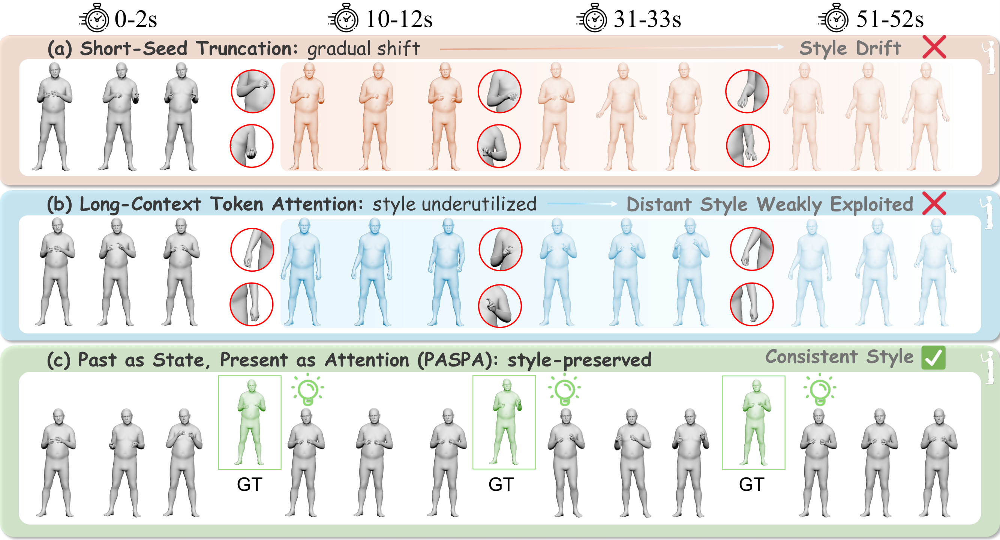
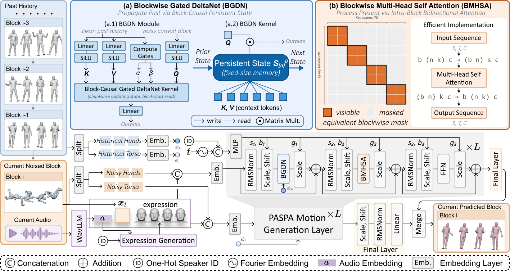

<div align="center">

# Past as State, Present as Attention: Persistent-State Blockwise Flow Matching for Long-Horizon Co-Speech Motion Generation

[](https://openreview.net/forum?id=dGHAQR4OKs)
[](https://ly403.github.io/PASPA/)
[](https://arxiv.org/abs/2610.32373)
[](https://github.com/Ly403/PASPA/)
[](LICENSE)

[English](README.md) | 简体中文

**🎉 已被第四十届神经信息处理系统大会（NeurIPS 2026）接收。**

Yi Liu<sup>1,3</sup>,
Xiangyue Zhang<sup>2</sup>,
Jianfang Li<sup>3,*</sup>,
Jia Ma<sup>1</sup>,
Yisheng He<sup>3</sup>,
Jianqiang Ren<sup>3</sup>

<sup>1</sup>同济大学 &nbsp;&nbsp;
<sup>2</sup>东京大学 &nbsp;&nbsp;
<sup>3</sup>阿里巴巴集团

<sup>*</sup>通讯作者：Jianfang Li

<br>

**过去 → 持续状态 &nbsp;&nbsp;·&nbsp;&nbsp; 现在 → 双向注意力**

<br>

<a href="#news">动态</a> &nbsp;•&nbsp;
<a href="#overview">概览</a> &nbsp;•&nbsp;
<a href="#method">方法</a> &nbsp;•&nbsp;
<a href="#installation">安装</a> &nbsp;•&nbsp;
<a href="#resources">权重</a> &nbsp;•&nbsp;
<a href="#training">训练</a> &nbsp;•&nbsp;
<a href="#evaluation">评估</a> &nbsp;•&nbsp;
<a href="#license">许可证</a>

</div>

<a id="news"></a>

## 📰 News

- ✅ **2026-11-21：** 开源 PASPA 训练、推理与评估代码，以及可移植的 BEAT2 复现配方。
- ✅ **2026-11-21：** 开源 BEAT2 All Speakers（`PID all`）和 1 Speaker / Scott（`PID 2`）最佳权重与动作生成结果，并提供完整 Hydra 配置与原始配方快照。
- ✅ **2026-11-21：** 开源 SHOW/TalkSHOW 支持，包括 WavLM Large face network 训练、LMDB 构建、三档 block/sequence profile、checkpoint 目录评估，以及兼容 TalkSHOW 和 DiffSHEG 的离线 evaluator。
- ✅ **2026：** PASPA 被 NeurIPS 2026 接收。

> [!NOTE]
> 本仓库不直接重新分发 BEAT2/BEAT-X 与 SHOW 原始数据、SMPL-X 模型文件及其他受限资产；仓库内附带或安装时下载的第三方文件仍遵循各自原始许可。

<p align="center">
  
</p>
<p align="center"><em>PASPA 将过去压缩为紧凑的持续状态，在 52 秒长时生成中保持稳定的动作风格。</em></p>

<a id="overview"></a>

## 🔍 项目概览

长时共语动作生成既要保留局部动作细节，也要维持缓慢变化的说话人风格。现有的分段生成方法通常只保留最近的一小段 seed，容易造成逐渐累积的风格漂移；另一类方法则显式关注越来越长的历史序列，不仅计算开销持续增长，也难以从有限的动作数据中学好。

PASPA 从一个简单的不对称性出发：过去的动作主要承载持续的风格信息，而当前片段包含快速变化的局部动态。因此，模型把较早的 block 压缩为循环传递的 Gated DeltaNet 状态，只在当前 block 内使用完整的双向注意力，即：**过去作为状态，现在作为注意力**。

### ✨ 核心亮点

- **长时风格持续性：** block 级循环状态选择性地汇总全部历史动作，无需保存不断增长的历史 token。
- **精细的当前动作：** block 内双向自注意力建模每个生成片段中的细粒度动态。
- **训练与推理协同设计：** 多 block 流匹配监督让模型接触不同长度的历史；prefill/decode 状态缓存避免重复计算过去。
- **可控条件引导：** hybrid classifier-free guidance 同时控制语音条件和历史依赖；同一套训练方案在 BEAT2 与 SHOW 上进行了评估。

<a id="method"></a>

## 🧠 方法概览

<p align="center">
  
</p>
<p align="center"><em>BGDN 汇总跨 block 历史，BMHSA 建模当前 block 内的细粒度动态。</em></p>

PASPA 使用 6 层、约 65.2M 参数的主干网络。每层由负责跨 block 历史传播的 Blockwise Gated DeltaNet（BGDN）和负责 block 内交互的 Blockwise Multi-Head Self-Attention（BMHSA）组成。训练时，四个连续 block 使用独立采样且弱单调的噪声等级，并被同时监督；推理时，历史 block 只需 prefill 一次形成固定大小的状态，之后每个新 block 在迭代流匹配解码中复用该缓存。

语音由冻结的 WavLM Large 提取特征。冻结的说话人条件 expression predictor 生成 100 维面部系数，PASPA 则生成 55 关节的身体与手部动作以及全局位移。发行版主配置使用 64 帧 block、256 帧训练窗口和 10 步采样。

### 🏆 主要结果

| 数据集与协议 | PASPA FGD ↓ | 表中最强基线 FGD ↓ |
|---|---:|---:|
| BEAT2，1 Speaker（`FGD × 10`） | **3.71** | GestureLSM：4.09 |
| BEAT2，All Speakers（`FGD × 10`） | **2.33** | GlobalDiff：2.63 |
| SHOW，DiffSHEG 协议 | **0.00111** | GlobalDiff：0.00198 |

论文还报告了 diversity、beat consistency/alignment、face MSE、长时退化、推理效率和盲测用户研究。对比数值时请严格使用论文指定的数据划分和 evaluator；TalkSHOW 与 DiffSHEG 的 FGD 数值不能直接互换。

> [!TIP]
> 如遇到问题、发现 bug 或希望讨论复现细节，欢迎在 [GitHub Issues](https://github.com/Ly403/PASPA/issues) 中提出。

<a id="installation"></a>

## 🛠️ 安装

发行版面向 Linux、Python 3.12 和 PyTorch 2.6。请根据 CUDA 环境选择安装脚本：

```bash
# CUDA 12.4
bash environment_setup.sh paspa

# CUDA 11.8
bash environment_setup118.sh paspa

conda activate paspa
```

两个安装脚本都会安装本项目，并把 EMAGE 资产、评估资产、Vocos 和 WavLM Large 下载到 `tools/`。训练保持 FP32；发行版入口不会启用 BF16 或 FP16。

<a id="resources"></a>

## 📦 数据与权重

### 📥 PASPA 预训练权重

| BEAT2 设置 | 权重 | 动作生成结果 |
|---|---|---|
| All Speakers（`PID all`） | [`best_pid_all.pth`](https://drive.google.com/file/d/1-phXGmj88j6xJHr1r_nNqHoPx8G6Vjwi/view?usp=sharing) | [下载结果](https://drive.google.com/file/d/1M9zc3v3XqEQWbq94OykWaf1jnUdTnLnM/view?usp=sharing) |
| 1 Speaker / Scott（`PID 2`） | [`best_pid_2.pth`](https://drive.google.com/file/d/1tZKrmwMVqItSUjB00Tdov0duedPoL7Hp/view?usp=sharing) | [下载结果](https://drive.google.com/file/d/1SvFMNXY1Jb-aOTMEMBc30pS3RH-59E4q/view?usp=sharing) |

两个 checkpoint 均由同一套训练配方产生。仓库同时保存了当时的
[完整 Hydra 配置](reproductions/beat2/best_checkpoint_config.yaml) 和
[原始 shell 快照](reproductions/beat2/original_best_recipe.sh)，用于追溯实验及核对
参数。这两份快照保留了历史机器路径；新训练请使用可移植的
`train_scripts/train_beat2.sh`。具体区别见[实验快照说明](reproductions/beat2/README.md)。

推理或评估时使用 `model.load_from=/path/to/checkpoint.pth`。只有需要恢复完整训练状态时才使用 `resume_from=/path/to/checkpoint.pth`。

### BEAT2 / BEAT-X

请按照数据集条款获取 BEAT2/BEAT-X。数据根目录应包含 `smplxflame_30/`、`wave16k/` 和 `train_test_split.csv`。每个 split 分别生成一个 LMDB；下面是 256 帧示例：

```bash
export BEAT2_ROOT=/absolute/path/to/beat_english_v2.0.0
export BEAT2_LMDB_DIR=/absolute/path/to/beat2_lmdb
export WAVLM_DIR="$PWD/tools/wavlm-libri-clean-100h-large"
mkdir -p "$BEAT2_LMDB_DIR"

for SPLIT in train val test; do
  CUDA_VISIBLE_DEVICES=0 python scripts/create_lmdb_optimized.py "$BEAT2_ROOT" \
    --split "$SPLIT" --seq_size 256 --stride_size 20 \
    --local_rotation 0 --model_type wavlm --model_id "$WAVLM_DIR" \
    --lmdb_path "$BEAT2_LMDB_DIR/${SPLIT}_seq256_global.lmdb"
done
```

仓库内的 `tools/best.pt` 是默认 speech model。如有需要，可用 `SPEECH_MODEL_CKPT` 覆写。

### TalkSHOW

TalkSHOW 使用独立的数据、身份映射、face checkpoint 和 rest-joint table，不会改变 BEAT2 的训练逻辑。简要流程如下：

1. 按照许可下载 SHOW，并创建不修改原数据的官方 split view。
2. 在 `reproductions/talkshow/` 中训练 WavLM Large face network。
3. 用 `scripts/create_lmdb_show.py` 为目标 profile 分别生成 train/validation/test LMDB。
4. 用 `scripts/build_rest_joint_position_show.py` 生成一份共享的 rest-joint table。

```bash
python reproductions/talkshow/scripts/prepare_split_view.py \
  --source-root /absolute/path/to/ExpressiveWholeBodyDatasetReleaseV1.0 \
  --output-root /absolute/path/to/talkshow_split \
  --split-file tools/show/split_more_than_2s.pkl \
  --expected-missing 55

export SHOW_SPLIT_ROOT=/absolute/path/to/talkshow_split
export SHOW_LMDB_DIR=/absolute/path/to/show_lmdb
export WAVLM_DIR="$PWD/tools/wavlm-libri-clean-100h-large"
export SEQ_SIZE=256
mkdir -p "$SHOW_LMDB_DIR"

for SPLIT in train val test; do
  CUDA_VISIBLE_DEVICES=0 python scripts/create_lmdb_show.py "$SHOW_SPLIT_ROOT" \
    --split "$SPLIT" --seq_size "$SEQ_SIZE" --stride_size 20 \
    --local_rotation 0 --model_type wavlm --model_id "$WAVLM_DIR" \
    --require_split_summary --feature_scope full_clip \
    --max_av_duration_delta_frames 3 --duration_mismatch_policy skip \
    --pid_offset 1 \
    --lmdb_path "$SHOW_LMDB_DIR/show_${SPLIT}_seq_size_${SEQ_SIZE}_stride_size_20_global.lmdb"
done

python scripts/build_rest_joint_position_show.py \
  --lmdb_path "$SHOW_LMDB_DIR/show_train_seq_size_${SEQ_SIZE}_stride_size_20_global.lmdb" \
  --smplx_model_path /absolute/path/to/emage_evaltools/smplx_models/smplx \
  --expected_pids 21 22 23 24 --expected-pid-offset 1 \
  --output "$SHOW_LMDB_DIR/rest_joint_position_show.mat"
```

资产要求、三档 profile、resume 行为和契约检查详见 [TalkSHOW face 训练](reproductions/talkshow/README_zh.md) 与 [完整 TalkSHOW pipeline](configs/talkshow_profile/README_zh.md)。

<a id="training"></a>

## 🚀 训练

所有主实验均通过提供的入口使用 `accelerate launch`。

### BEAT2 / BEAT-X

```bash
export BEAT2_TRAIN_LMDB=/absolute/path/to/train.lmdb
export BEAT2_VALIDATION_LMDB=/absolute/path/to/validation.lmdb
export BEAT2_TEST_LMDB=/absolute/path/to/test.lmdb

bash train_scripts/train_beat2.sh
```

论文配置使用 4 张 GPU、每卡 batch size 72、1000 epochs。仅在需要时覆写：

```bash
CUDA_VISIBLE_DEVICES=0,1,2,3,4,5,6,7 \
NUM_PROCESSES=8 TRAIN_BATCH_SIZE=32 NUM_EPOCHS=1000 \
bash train_scripts/train_beat2.sh
```

通过 Hydra 参数恢复主模型 checkpoint：

```bash
bash train_scripts/train_beat2.sh \
  resume_from=/absolute/path/to/epoch_N_step_M.pth
```

### TalkSHOW 主模型

先设置五个必需的资产路径：

```bash
export SHOW_LMDB_DIR=/absolute/path/to/show_lmdb
export TALKSHOW_FACE_CKPT=/absolute/path/to/face/ckpt-999.pth
export WAVLM_DIR=/absolute/path/to/wavlm-libri-clean-100h-large
export SHOW_REST_JOINT_PATH="$SHOW_LMDB_DIR/rest_joint_position_show.mat"
export EMAGE_EVALTOOLS_DIR=/absolute/path/to/emage_evaltools
```

选择与 LMDB 匹配的一档 profile：

| `TALKSHOW_PROFILE` | Block | Sequence | 默认 epochs |
|---|---:|---:|---:|
| `block16_seq64` | 16 | 64 | 1000 |
| `block32_seq128` | 32 | 128 | 1000 |
| `block64_seq256` | 64 | 256 | 1000 |

```bash
TALKSHOW_PROFILE=block64_seq256 TALKSHOW_MODE=train \
bash train_scripts/run_talkshow.sh
```

TalkSHOW 默认使用 4 张 GPU、每卡 batch size 72、1000 epochs，并保持 FP32。可选覆写项为 `CUDA_VISIBLE_DEVICES`、`NUM_PROCESSES`、`TRAIN_BATCH_SIZE`、`NUM_EPOCHS` 和 `NUM_WORKERS`。恢复训练时必须使用相同 profile，且 epoch 数表示完整目标：

```bash
TALKSHOW_PROFILE=block64_seq256 TALKSHOW_MODE=train \
bash train_scripts/run_talkshow.sh \
  resume_from=/absolute/path/to/epoch_N_step_M.pth
```

<a id="evaluation"></a>

## 🎬 推理与评估

只加载模型权重测试 TalkSHOW checkpoint：

```bash
TALKSHOW_PROFILE=block64_seq256 TALKSHOW_MODE=test \
bash train_scripts/run_talkshow.sh \
  model.load_from=/absolute/path/to/epoch_N_step_M.pth
```

只跑 validation 时使用 `TALKSHOW_MODE=validation`。两种评估模式都要求 `model.load_from`，并拒绝 `resume_from`。

常用评估入口：

```bash
# BEAT2 checkpoint 目录评估
python scripts/eval_pth_dir.py --help

# TalkSHOW checkpoint 目录并行评估
python scripts/eval_talkshow_pth_dir.py --help

# EMAGE 指标、TalkSHOW 原仓库协议和 DiffSHEG SHOW 协议
python scripts/emage_eval.py --help
python scripts/talkshow_official_eval.py --help
python scripts/diffsheg_show_eval.py --help
```

TalkSHOW 原仓库 evaluator 与 DiffSHEG 使用不同的特征提取器和数值尺度，两者的 FGD 不能直接比较。详见 [TalkSHOW 官方评估](configs/talkshow_profile/OFFICIAL_EVAL_zh.md) 和 [DiffSHEG 评估](configs/talkshow_profile/DIFFSHEG_EVAL_zh.md)。

## 🗂️ 仓库结构

```text
configs/                 Hydra 配置
diffusion/               PASPA 模型、trainer、sampler、指标和数据代码
reproductions/talkshow/  固定版本的 TalkSHOW face/body 复现
reproductions/beat2/     最佳权重的原始配置与脚本快照
scripts/                 数据准备、评估和渲染工具
train_scripts/           BEAT2 与 TalkSHOW 主入口
tools/show/              TalkSHOW 契约检查与转换工具
```

设计原理详见 [PRINCIPLES_zh.md](PRINCIPLES_zh.md)。

## 🤝 基于的开源项目

PASPA 基于以下公开项目开发。感谢这些项目的作者开放代码和模型。

- [SANA](https://github.com/NVlabs/Sana)：作为流匹配训练的基础框架。
- [GlobalDiff](https://github.com/Human3DAIGC/GlobalDiff)：用于 BEAT2 数据处理、全局旋转 FK 与损失组件、部分网络组件，以及预训练 audio-to-expression 权重。
- [Flash Linear Attention](https://github.com/fla-org/flash-linear-attention)：提供 Gated DeltaNet 实现和 Triton kernel；本项目在此基础上扩展了 block-causal 执行。
- [Self-Forcing](https://github.com/guandeh17/Self-Forcing)：作为自回归扩散推理流程的参考。
- [SMPL-X](https://github.com/vchoutas/smplx)：提供参数化人体模型和 SMPL-X 表示。
- [EMAGE / Character Policy](https://github.com/haiyangliu0/character-policy)：提供 BEAT2 资产与评估工具。
- [TalkSHOW](https://github.com/yhw-yhw/TalkSHOW)：提供 SHOW face/body 流程；本仓库将其 face predictor 适配到 WavLM。
- [DiffSHEG](https://github.com/JeremyCJM/DiffSHEG)：提供 SHOW 评估组件和预训练特征提取器。
- [WavLM](https://github.com/microsoft/unilm/tree/master/wavlm)：提供冻结的 WavLM Large 语音特征。

<a id="license"></a>

## 📄 许可证

> [!IMPORTANT]
> PASPA 作者原创的源代码采用 [Apache License 2.0](LICENSE) 发布。该许可证不会
> 重新授权任何第三方组件或资产。BEAT2/BEAT-X、SHOW/TalkSHOW、SMPL-X、安装时
> 下载的模型资产、预训练特征提取器及数据集衍生文件仍遵循各自的原始条款。其中，
> TalkSHOW/SHOW 与 SMPL-X 资产按照各自条款仅限非商用科学研究用途。详情见
> [NOTICE](NOTICE) 和 [THIRD_PARTY_NOTICES.md](THIRD_PARTY_NOTICES.md)。

## 📝 引用

```bibtex
@inproceedings{
liu2026past,
title={Past as State, Present as Attention: Persistent-State Blockwise Flow Matching for Long-Horizon Co-Speech Motion Generation},
author={Yi Liu and Xiangyue Zhang and Jianfang Li and Jia Ma and Yisheng He and Jianqiang Ren},
booktitle={The Fortieth Annual Conference on Neural Information Processing Systems},
year={2026},
url={https://openreview.net/forum?id=dGHAQR4OKs}
}
```

## 🙏 致谢

本工作得到阿里巴巴研究实习生计划支持。（论文原文：This work was supported by the Alibaba Research Intern Program.）

同时请遵守 BEAT2/BEAT-X、SHOW/TalkSHOW、SMPL-X、EMAGE、WavLM 及所有第三方 checkpoint 的许可和使用条款。
